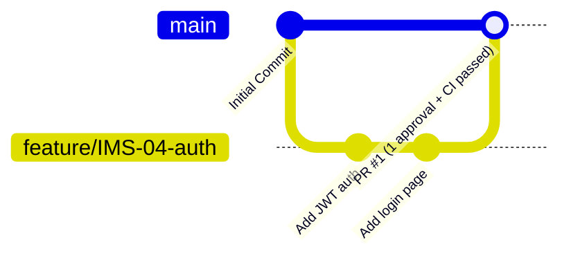

# GitHub Branch Protection Policy (`main`)

Subtask: **IMS-03.3**  
Assignee: **Meherab (Dev 2)**  
Acceptance Criteria: **Main needs a pull request and one approval**

---

## 1. Overview

To maintain code quality (**NFR-MNT-01**), prevent security vulnerabilities (**NFR-SEC-03**), and ensure continuous deployability (**NFR-OPS-01**), direct pushes to the `main` branch are blocked. All code must enter `main` through a Pull Request that has received at least **one approved review** from a peer and has passed all CI status checks.

---

## 2. GitHub UI Setup Instructions (Step-by-Step)

Once this repository is pushed to GitHub:

1. Navigate to your repository on GitHub.
2. Click **Settings** (tab at the top).
3. In the left sidebar under _Code and automation_, click **Branches**.
4. In the _Branch protection rules_ section, click **Add branch ruleset** (or **Add rule**).
5. Configure the following rules:

### A. Target Branch

- **Branch name pattern**: `main`

### B. Protect Matching Branches

Enable the following checkboxes:

- [x] **Require a pull request before merging**
  - [x] **Require approvals**: Set to `1` (or more).
  - [x] **Dismiss stale pull request approvals when new commits are pushed** (ensures any subsequent modifications receive re-review).
  - [x] **Require conversation resolution before merging** (all comments and review threads must be resolved).
- [x] **Require status checks to pass before merging**
  - [x] **Require branches to be up to date before merging**
  - In the search bar for status checks, select:
    - `Code Formatting & Secret Audit (NFR-SEC-03, NFR-MNT-01)`
    - `Backend Lint & Typecheck (NFR-MNT-01, NFR-OPS-01)`
    - `Frontend Lint & Build (NFR-MNT-01, NFR-OPS-01)`
    - `API Tests against Test Database (NFR-OPS-01)`
- [x] **Do not allow bypassing the above settings**
  - Enforce rules for repository administrators as well.
- [x] **Block force pushes** (prevents `git push --force`).
- [x] **Block deletions** (prevents deletion of `main`).

6. Click **Create** or **Save changes**.

---

## 3. Automated Configuration via GitHub CLI (`gh`)

If you have the `gh` CLI authenticated on your machine, you can apply these branch protection rules directly with this command:

```bash
gh api --method PUT \
  -H "Accept: application/vnd.github+json" \
  /repos/:owner/:repo/branches/main/protection \
  -f required_status_checks='{"strict":true,"contexts":["Code Formatting & Secret Audit (NFR-SEC-03, NFR-MNT-01)","Backend Lint & Typecheck (NFR-MNT-01, NFR-OPS-01)","Frontend Lint & Build (NFR-MNT-01, NFR-OPS-01)"]}' \
  -F enforce_admins=true \
  -f required_pull_request_reviews='{"dismiss_stale_reviews":true,"require_code_owner_reviews":false,"required_approving_review_count":1}' \
  -F restrictions=null \
  -F allow_force_pushes=false \
  -F allow_deletions=false
```

---

## 4. Development Workflow



1. **Create a topic branch from `main`**:
   ```bash
   git checkout main
   git pull origin main
   git checkout -b feature/IMS-XX-description
   ```
2. **Develop and verify locally**:
   ```bash
   npm run lint
   npm run format:check
   npm run dev
   ```
3. **Push branch and open Pull Request**:
   ```bash
   git push origin feature/IMS-XX-description
   ```
4. **Fill out the Pull Request Template** (`.github/pull_request_template.md`).
5. **Request review**: Require at least 1 teammate approval before merging.
