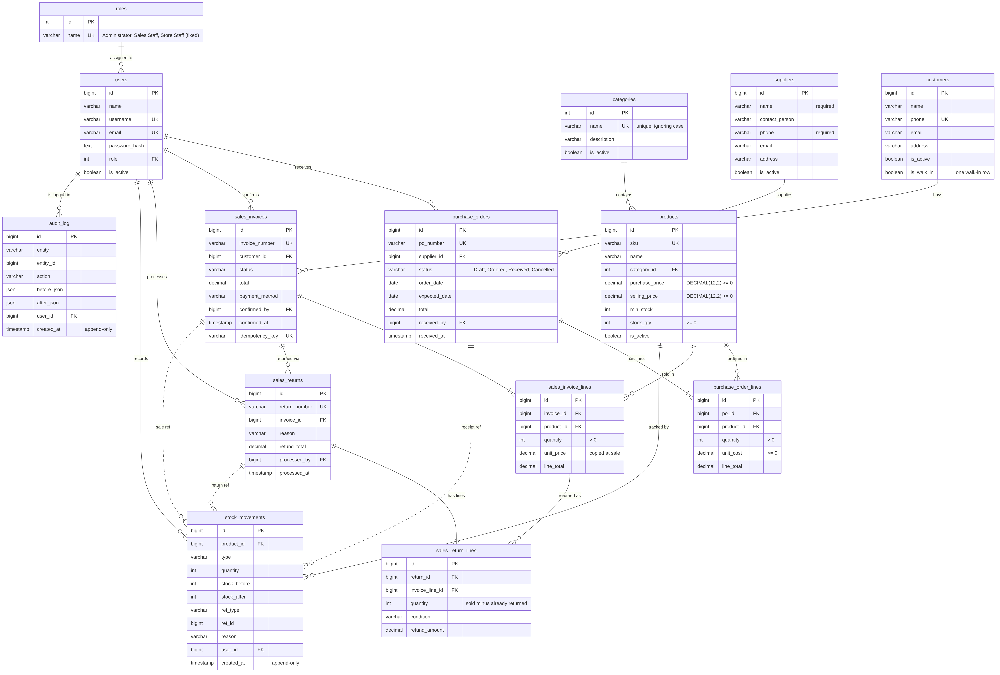
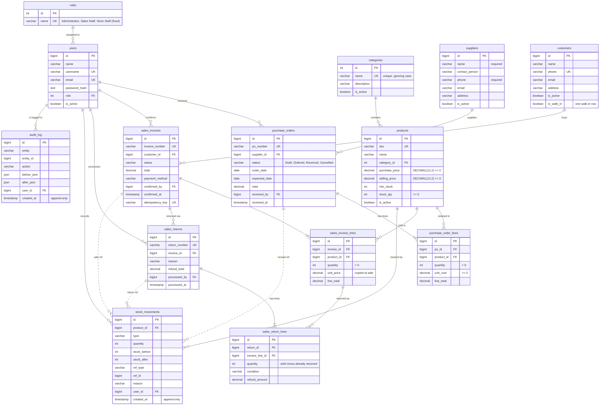

# SmartMart ER Diagram

| | |
|---|---|
| **Task** | IMS-02.1 Draw the ER diagram of the 14 entities |
| **Author** | Dev 1 · Md. Rashadul Islam |
| **Reviewer** | Dev 2 · MD Meherab Hossain Nowshad |
| **Source** | SRS Group 1 (SmartMart), main SRS section 5 "Data requirements" |
| **Status** | Draft for review (IMS-02.4) |

The 14 tables exactly as SRS section 5 lists them, with their key fields and links. Keys, checks and the ledger rules are in [schema.md](./schema.md). Editable source: [erd.dbml](./erd.dbml) (open it in dbdiagram.io).

## Diagram (renders on GitHub)

## How to read it

- `||--o{` one to zero-or-many, e.g. one category has many products.
- `||--|{` one to one-or-many, e.g. a purchase order has at least one line.
- Dotted lines: logical link through `stock_movements.ref_type` + `ref_id`, not a real foreign key.
- `created_at`, `updated_at` and `created_by` are on every business table (section 5) but are left out of the diagram to keep it readable.

## The 14 tables

| # | Table | Links to |
|---|---|---|
| 1 | users | roles |
| 2 | roles | users |
| 3 | categories | products |
| 4 | products | categories |
| 5 | suppliers | purchase_orders |
| 6 | customers | sales_invoices |
| 7 | purchase_orders | suppliers, users |
| 8 | purchase_order_lines | purchase_orders, products |
| 9 | sales_invoices | customers, users |
| 10 | sales_invoice_lines | sales_invoices, products |
| 11 | sales_returns | sales_invoices, users |
| 12 | sales_return_lines | sales_returns, sales_invoice_lines |
| 13 | stock_movements | products, users |
| 14 | audit_log | users |
